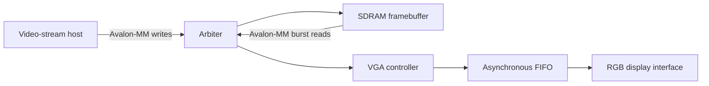

# FPGA Video Controller

A SystemVerilog RTL design for displaying a framebuffer from SDRAM on an FPGA-driven
LCD/VGA-style video interface.

The main design targets an 800 × 480 RGB output. A video-stream host writes 32-bit pixels
to SDRAM through Avalon-MM, while the display engine fetches the same framebuffer in bursts,
crosses into the pixel-clock domain through an asynchronous FIFO, and generates the timing
and RGB signals for the display.

## Architecture



The top-level design contains two clock domains:

- **System domain — 100 MHz:** SDRAM access, Avalon-MM transactions and arbitration.
- **Pixel domain — 32 MHz:** video timing, FIFO consumption and RGB output.

A two-flip-flop reset synchronizer produces a reset local to the pixel domain, avoiding an
unsafe reset release across the two clock domains.

## Main video path

### Video timing generator

`controleur_video/SoCFPGA/src/vga.sv` implements the raster generator.

- Active resolution: **800 × 480**
- Pixel format: **24-bit RGB** at the display output
- Horizontal timing: 40-pixel front porch, 48-pixel sync pulse and 40-pixel back porch
- Vertical timing: 13-line front porch, 3-line sync pulse and 29-line back porch
- Active-low horizontal and vertical synchronization signals
- RGB output is black outside the active display area

The module tracks horizontal and vertical pixel positions, drives `HS`, `VS` and
`BLANK`, and only consumes a pixel from the FIFO during active video.

### Framebuffer reader

The VGA block reads the framebuffer through a 32-bit Avalon-MM host interface.

- Each read request uses a burst of **32 words**.
- The byte address wraps after one full `800 × 480 × 4`-byte framebuffer.
- Returned words enter a **24-bit asynchronous FIFO** with a depth of 256 entries.
- Pixel output starts after the FIFO has been filled before the active display window,
  reducing the risk of underflow during a frame.

### Avalon-MM arbitration

`controleur_video/SoCFPGA/src/avalon_intercon.sv` arbitrates SDRAM access between:

1. the incoming stream that writes framebuffer data; and
2. the VGA engine that reads it back for display.

The arbiter keeps ownership through an active burst, then hands the bus to the other requester
when the current transfer is complete. It forwards address, byte-enable, read/write data and
burst-count signals to SDRAM, and routes the corresponding response signals back to the
selected requester.

## Verification and implementation flow

The simulation environment instantiates a reduced **160 × 90** display configuration to make
simulation practical. It includes timing assertions for active video, blanking intervals and
horizontal/vertical synchronization, and can dump rendered frames as PPM images.

The repository also includes a synthesis flow for the target FPGA board, including Qsys/IP
generation, timing constraints, pin assignments and programming commands.

### Simulation

The included Makefile expects QuestaSim/ModelSim-compatible `vlog` and `vsim` commands,
plus the required Avalon verification libraries.

```bash
cd controleur_video/SoCFPGA/sim
make compile
make simu_batch
```

For waveform-based debugging:

```bash
make simu_gui
```

### Synthesis and programming

The synthesis flow uses Intel Quartus tools.

```bash
cd controleur_video/SoCFPGA/syn
make test_syn
make syn
make program
```

`make test_syn` performs analysis and elaboration; `make syn` runs the full compilation;
and `make program` programs the generated bitstream through JTAG.

## Additional RTL blocks

Besides the video controller, this repository preserves related reusable designs:

- `controleur_memoire/` — an Avalon-MM block RAM controller with byte enables and
  burst read/write handling.
- `median/` — a parameterized median-filter controller. The default configuration
  operates on a 9-sample window.
- `avalon_if/` — a SystemVerilog Avalon-MM interface definition with host, agent and
  monitor modports.
- `ExoSim/` — simulation material for an event-driven hardware model.

## Repository layout

```text
controleur_video/
├── SoCFPGA/
│   ├── src/       # Top-level design, VGA engine and SDRAM arbiter
│   ├── tb_src/    # Testbench, timing checks and example framebuffer
│   ├── sim/       # ModelSim/Questa simulation flow
│   └── syn/       # Quartus synthesis and programming flow
├── ips/           # PLL, FIFO, interfaces and platform support
└── docs/          # Target-board documentation

controleur_memoire/ # Standalone Avalon-MM BRAM controller
median/             # Median-filter RTL and testbenches
avalon_if/          # Avalon-MM interface definition
ExoSim/             # Event-driven simulation material
```

## Project status

This repository is a preserved hardware-design project rather than an actively maintained
product. It is kept as a technical record of RTL design, multi-clock video pipelines,
Avalon-MM transactions, simulation and FPGA implementation flow.
